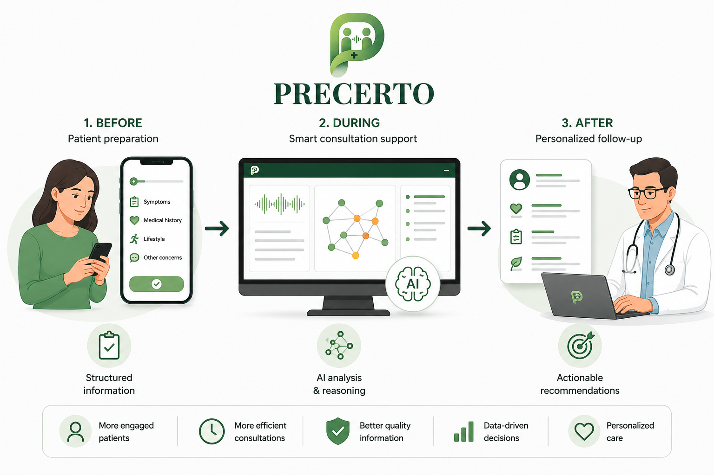
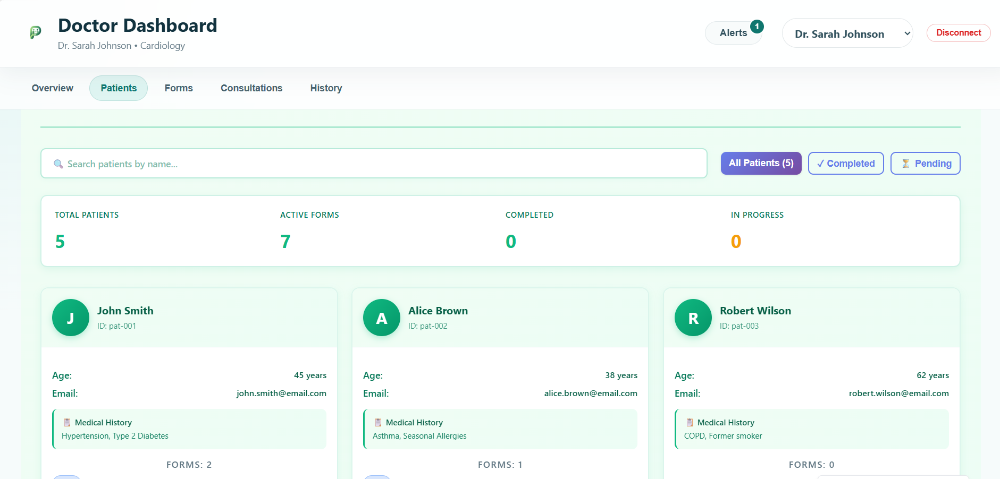
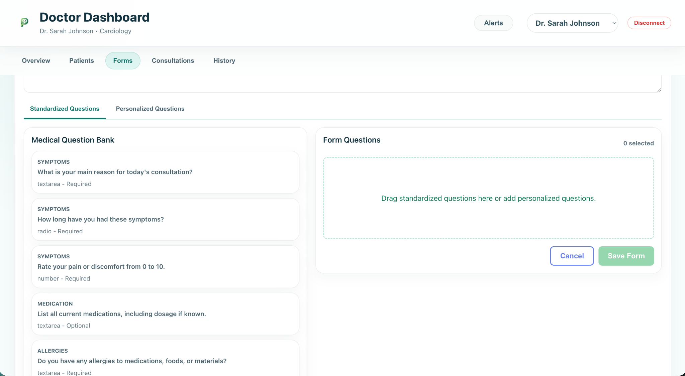
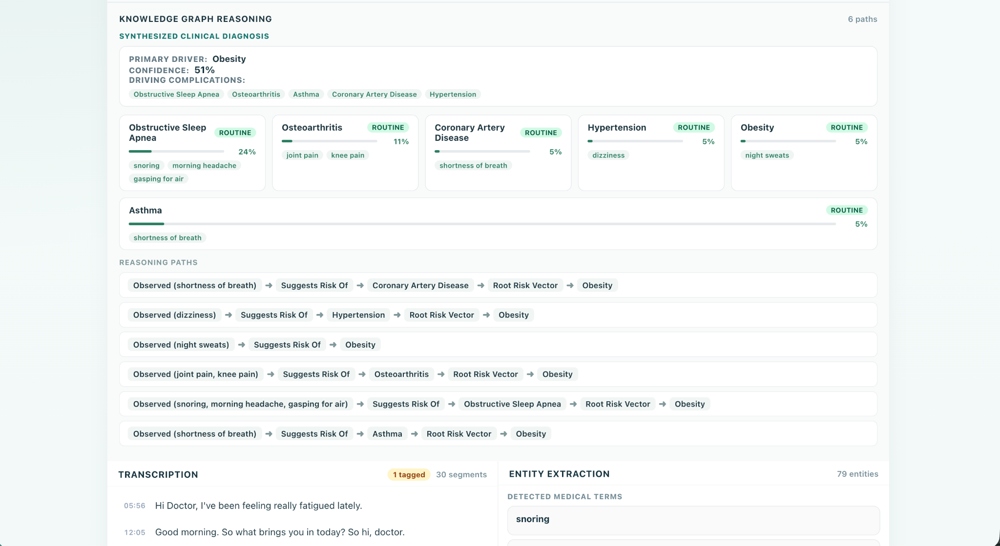
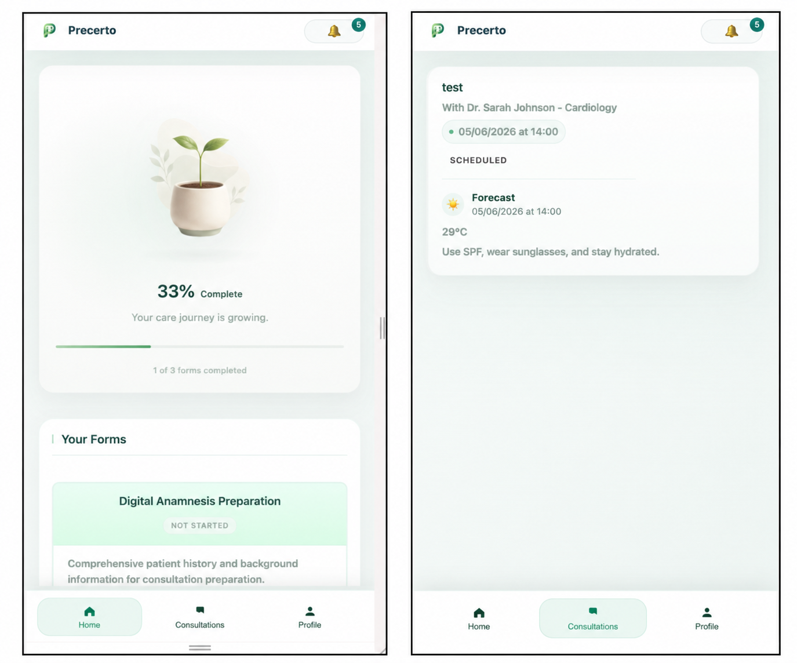
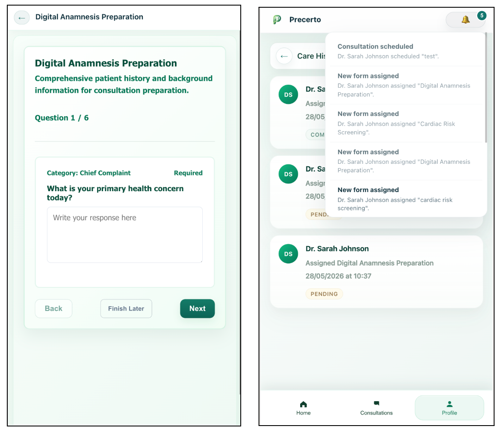

# Precerto

Precerto is a prototype for digital health research. It combines pre-consultation forms, live consultation transcription, medical entity extraction, a small knowledge graph, and explainable reasoning surfaced to a clinician UI.

This repository contains a FastAPI backend and a React frontend. The codebase is an academic proof of concept and is not a clinical medical device. 



*Figure 1. Overview of the Precerto healthcare platform illustrating the patient preparation process, AI-assisted consultation support, and personalized post-consultation recommendations*

## Main features

- Pre-consultation form capture and storage
- Live audio capture and real-time transcription (Faster-Whisper)
- Medical entity extraction using SciSpacy
- Deterministic reasoning over a knowledge graph (Neo4j / Kuzu)
- Clinician dashboard and patient-facing UI (React + Vite)

## How it works (simple)

1. A patient fills out a pre-consultation form. Text is stored in the backend database.
2. During a consultation the frontend streams microphone audio to the backend over WebSocket.
3. Backend transcribes audio to text (Faster-Whisper) and extracts entities with SciSpacy.
4. Extracted entities (form + audio) are merged and queried against a local knowledge graph. The graph returns deterministic paths (e.g., Symptom → INDICATES → Diagnosis).
5. The clinician UI shows transcripts, extracted entities, and the reasoning path for review.

## Tech stack (from this repo)

- Backend: Python, FastAPI
- Transcription: Faster-Whisper
- NLP: SciSpacy / SpaCy
- Knowledge graph: Neo4j and Kuzu bindings present in requirements
- Database: SQLite (SQLAlchemy models under `backend/app/db`)
- Frontend: React, Vite, Tailwind (under `ui/`)

## Project layout (high-level)

- backend/: FastAPI app and Python services
  - backend/main.py — server entrypoint
  - backend/app/api — API routes
  - backend/app/core — configuration
  - backend/app/db — models and database
  - backend/app/services — audio, NLP, reasoning logic
- ui/: React/Vite frontend
- data/: sample graph CSVs used by scripts
- scripts/: utility scripts for testing and building the graph

## Screenshots

### Doctor side

*Figure 2. Doctor dashboard patient management interface showing patient overview, medical information, and consultation status tracking*


*Figure 3. Doctor dashboard interface for creating and customizing patient intake forms using standardized and personalized medical questions*


*Figure 4. Consultation results interface showing real-time transcription, medical entity extraction, Knowledge Graph reasoning paths, and AI-supported diagnostic suggestions*

### Patient side

*Figure 5. Patient mobile application interface showing the home screen with progress visualization and consultation forms, alongside the consultations overview screen*


*Figure 6. Patient mobile application interface showing the medical form completion process and notification system*

## Installation and setup

Prerequisites:

- Python 3.10 or newer (see `pyproject.toml`)
- Node.js and npm for the frontend
- (Optional) Neo4j running locally if you want the graph-backed features

Backend (recommended using `uv` if available):

```bash
cd backend
uv sync
cp .env.example .env
# Edit .env to set credentials or keys (NEO4J, LLM_API_KEY, ...)
uv run python main.py
```

Backend (alternative, using virtualenv and pip):

```bash
cd backend
python -m venv .venv
source .venv/bin/activate
pip install -r requirements.txt
cp .env.example .env
python main.py
```

Frontend:

```bash
cd ui
npm install
npm run dev
```

## Environment variables and external services

The backend reads configuration from `backend/.env.example`. Key variables include:

- `NEO4J_URI`, `NEO4J_USERNAME`, `NEO4J_PASSWORD` — Neo4j connection for the knowledge graph
- `LLM_PROVIDER`, `LLM_MODEL`, `LLM_API_KEY` — optional external LLM credentials
- `WHISPER_MODEL_PATH` — path to any local whisper model used by Faster-Whisper